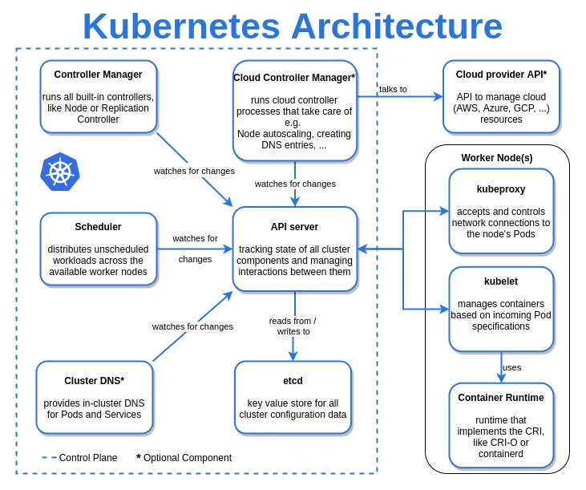

# Arquitectura básica

Un **clúster** de Kubernetes tiene dos partes: el **plano de control** (la “cabeza”) y uno o más **nodos worker** (la “fuerza”). En un laboratorio una misma máquina puede cumplir ambos papeles.

## Plano de control (Control Plane)

Toma decisiones globales (dónde programar cargas) y reacciona a eventos del clúster (por ejemplo, crear un contenedor cuando un nodo falla).

| Componente | Rol |
| ---------- | --- |
| **kube-apiserver** | “Puerta de entrada”. Toda petición de `kubectl` o de la API pasa por aquí; valida y procesa la configuración. |
| **etcd** | Almacén clave-valor consistente con **todo** el estado del clúster. Si no está en etcd, Kubernetes no lo conoce. |
| **kube-scheduler** | Observa Pods sin nodo y elige un worker según recursos y restricciones. |
| **kube-controller-manager** | Ejecuta controladores que comparan el estado actual con el deseado y corrigen diferencias. |

## Nodos worker

Aquí corren los contenedores de tus aplicaciones.

| Componente | Rol |
| ---------- | --- |
| **kubelet** | Agente en cada nodo. Recibe instrucciones del plano de control y mantiene los contenedores sanos. |
| **kube-proxy** | Proxy de red en el nodo. Gestiona reglas para que el tráfico llegue a los Pods (desde dentro o fuera del clúster). |
| **Container runtime** | Software que ejecuta contenedores (`containerd`, `CRI-O`, etc.). |

`kubectl` es solo un **cliente**: habla con el API server; no ejecuta contenedores. Kubernetes puede usar imágenes construidas con Docker aunque el runtime del nodo no sea Docker Engine.

## Del comando al contenedor

1. Enviamos una definición al **API server** (`kubectl apply`, `create`, …).
2. Se registra el **estado deseado** en **etcd**.
3. Los **controladores** crean o actualizan los recursos necesarios.
4. El **scheduler** asigna los Pods a nodos.
5. El **kubelet** pide al **runtime** ejecutar los contenedores.

## Tres abstracciones que usaremos ya

Kubernetes no “corre contenedores sueltos” en producción: los envuelve en objetos de más alto nivel.

| Objeto | Idea |
| ------ | ---- |
| **Pod** | Unidad mínima desplegable (normalmente un contenedor). |
| **Deployment** | Mantiene N réplicas idénticas de un Pod y gestiona actualizaciones. |
| **Service** | Endpoint de red estable hacia un conjunto de Pods (las IP de los Pods cambian). |

## Desafío

Identifica quién recibe una solicitud, quién elige el nodo y quién ejecuta el contenedor. Explica por qué un Pod sin nodo asignado requiere investigar el scheduling.

**Entrega:** cinco pasos con tus palabras.

**Referencia:** [Componentes del clúster](https://kubernetes.io/docs/concepts/overview/components/).
