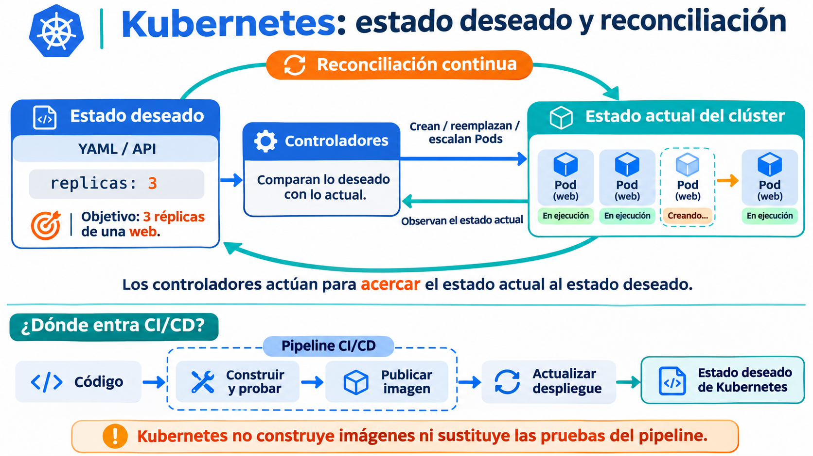

# Introducción a Kubernetes

## ¿Qué problema resuelve?

Con `docker run` (o Docker Compose) una aplicación funciona bien en **una** máquina. En producción aparecen otras preguntas:

- Si un servidor se cae, ¿quién reinicia los contenedores en otra máquina?
- ¿Cómo escalamos durante un pico de tráfico?
- ¿Cómo actualizamos sin cortar el servicio?

**Kubernetes** (abreviado **K8s**) es una plataforma open source de **orquestación de contenedores**. Automatiza el despliegue, el escalado y la administración de aplicaciones en contenedores a lo largo de un **clúster** de máquinas.

Declaramos un **estado deseado**, por ejemplo “tres réplicas de esta web”. Los controladores comparan ese estado con el estado actual y actúan para acercarlos. Ese proceso se llama **reconciliación**.

Kubernetes **no** construye por sí solo nuestras imágenes ni sustituye las pruebas del pipeline de CI/CD. El pipeline puede publicar una imagen y después actualizar el despliegue del clúster.

## Qué aprenderemos en este módulo

| Tema | Qué lograrás |
| ---- | ------------ |
| Arquitectura | Control plane, nodos y el camino de un comando a un contenedor |
| Entorno | Terminal de Killercoda / KodeKloud (Minikube o Kind, opcional) |
| Pods | Unidad mínima de ejecución |
| Deployments | Réplicas, self-healing, actualización y rollback |
| Services | Acceso estable a los Pods |
| YAML | Manifiestos declarativos |
| Diagnóstico | Pending, ImagePullBackOff, CrashLoopBackOff |

Ingress, almacenamiento persistente y gestión de secretos quedan para módulos posteriores.

Todas las prácticas se realizan en **Killercoda o KodeKloud**. La instalación local es una alternativa opcional.

## Desafío

Describe qué debería hacer el sistema cuando una aplicación necesita pasar de una a tres réplicas y una de ellas se elimina.

**Entrega:** un párrafo que diferencie imagen, contenedor y orquestador.

**Referencia:** [Descripción general de Kubernetes](https://kubernetes.io/docs/concepts/overview/).
